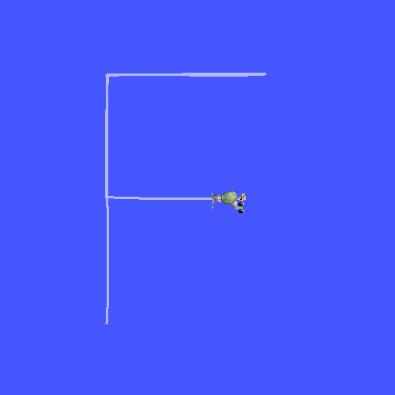

# ros2-learning

ROS 2 Jazzy を **Windows 11 にネイティブで** 入れて学ぶ記録です。WSL2 も Docker も使わず、[pixi](https://pixi.sh/) と [RoboStack](https://robostack.github.io/) で環境を作っています。

ゴールは、ROS 2 の基礎 → Isaac Sim との連携 → Isaac Lab での強化学習、まで進むことです。

> この方法を選んだ理由: Isaac Sim 6 の公式手順でも、Windows では pixi で入れる ROS 2 Jazzy が使われていて、WSL2 は非推奨になっている（[Isaac Sim: ROS 2 Installation](https://docs.isaacsim.omniverse.nvidia.com/latest/installation/install_ros.html)）。

## 環境

| 項目 | 内容 |
|---|---|
| OS | Windows 11 Home |
| ROS 2 | Jazzy（RoboStack） |
| パッケージ管理 | pixi 0.81.0 |
| Python | 3.12 |
| GPU | RTX 4070（12GB） |

## 使い方

```powershell
# pixi を入れる（初回のみ）
winget install prefix-dev.pixi

# 環境を作る（初回は数分かかる）
pixi install

# 自作パッケージをビルド
pixi run build

# 2つのターミナルで実行
pixi run talker     # 0.5秒ごとに "Hello World: N" を送る
pixi run listener   # 受け取って表示する
```

サービス・パラメータ・launch:

```powershell
# サービス（2つの整数を足す）
pixi run cmd /c "call install\local_setup.bat && ros2 run py_pubsub add_server"
pixi run cmd /c "call install\local_setup.bat && ros2 run py_pubsub add_client 2 3"   # → 5

# launch で talker と listener をまとめて起動し、パラメータを渡す
pixi run cmd /c "call install\local_setup.bat && ros2 launch py_pubsub pubsub.launch.py greeting:=Konnichiwa period:=1.0"

# 動いている途中でパラメータを変える
pixi run ros2 param set /param_talker greeting Changed
```

アクション（時間のかかる仕事を頼み、途中経過を受け取る。取り消しもできる）:

```powershell
pixi run cmd /c "call install\local_setup.bat && ros2 run py_pubsub fibonacci_server"
pixi run cmd /c "call install\local_setup.bat && ros2 run py_pubsub fibonacci_client --ros-args -p order:=10"
# → 途中経過 [0, 1, 1]、[0, 1, 1, 2] … のあと、結果 [0, 1, 1, 2, 3, 5, 8, 13, 21, 34, 55]
pixi run cmd /c "call install\local_setup.bat && ros2 run py_pubsub fibonacci_client --ros-args -p order:=10 -p cancel_after:=1.2"
# → 1.2 秒で取り消し、[0, 1, 1, 2, 3] で止まる
```

C++ のノードと turtlesim:

```powershell
pixi run talker_cpp          # C++ の talker（先に vcrt_local が動く。下の「Windows で詰まったこと」を参照）
pixi run turtlesim           # 亀の画面を開く
pixi run turtle_draw         # 亀に「F」の字を描かせる（別のターミナルで）
pixi run check_turtle_draw   # turtlesim を起動せずに、亀を動かす制御だけを確かめる
```



亀の位置（`/turtle1/pose`）を見ながら、次の点との距離と向きのずれに比例して速度（`/turtle1/cmd_vel`）を決める（P 制御）。5 つの点すべてに誤差 0.05 以内で着いた。

### ロボット × ブロックチェーン: 稼働台帳（robot_ledger）

ロボットの仕事を「**署名つき・ハッシュでつないだ台帳**」に記録し、**使用範囲の中で終わった仕事だけを数えて請求額を出す**。ブロックチェーンの芯（ID・署名・追記だけの鎖）を、小さく自分で作った練習。

```powershell
pixi run turtlesim                                                                      # 1. 亀の画面
pixi run cmd /c "call install\local_setup.bat && ros2 run robot_ledger ledger_recorder"  # 2. 台帳に記録するノード
pixi run turtle_draw                                                                    # 3. 亀が「F」を描く（仕事をする）
# 4. 台帳を確かめる → 請求額を出す
pixi run cmd /c "call install\local_setup.bat && ros2 run robot_ledger ledger_verify ledger/turtle1.jsonl --pubkey-file ledger/turtle1.pub"
pixi run cmd /c "call install\local_setup.bat && ros2 run robot_ledger ledger_bill ledger/turtle1.jsonl --pubkey-file ledger/turtle1.pub --price 100 --max-error 0.05"
```

| しくみ | 中身 |
|---|---|
| ID | ロボットごとの Ed25519 の鍵。公開鍵のハッシュがロボットの ID（例: `robot:ac155ef6283cf4e9`） |
| 署名 | 1行ずつロボットの秘密鍵で署名。秘密鍵（`ledger/*.key`）は Git に入れない |
| ハッシュの鎖 | 各行に1つ前の行のハッシュ。途中を書き換えるとつながらなくなる |
| 請求 | 登録された公開鍵で台帳を確かめてから、契約の「使用範囲」（誤差の上限）の中の仕事だけを数える |

結果（2026-11-05）:
- 亀が5つの点で仕事をし、台帳は7行（開始・仕事5件・終了）。確認は **OK**
- 契約「1件100円・誤差0.05以内」→ **5件・500円**。「誤差0.046以内」に厳しくすると **3件・300円**（2件は範囲の外）
- 台帳の1か所（点2の誤差 0.048 → 0.001）を書き換えると、**「中身が書き換えられている」で NG**、請求も拒否
- テスト12件（書き換え・削除・ハッシュの計算し直し・別の鍵で作った偽の台帳・請求）: `python -m pytest src/robot_ledger/test`

まだないもの: 何社もで台帳を持ち合う仕組み（合意）、公開のブロックチェーンへの記録、受け取る側（工場）の署名、支払い。

確認用のコマンド:

```powershell
pixi run ros2 node list         # /minimal_publisher, /minimal_subscriber
pixi run ros2 topic info /topic # Publisher 1 / Subscription 1
pixi run ros2 topic hz /topic   # 約 2Hz
```

## 中身

| パス | 内容 |
|---|---|
| [`src/py_pubsub`](src/py_pubsub) | Python のパブリッシャー・サブスクライバー、サービス、パラメータ、launch、tf2、rosbag2、アクション（公式チュートリアル）と、亀に字を書かせるノード |
| [`src/robot_ledger`](src/robot_ledger) | ロボットの稼働を署名つきの台帳に記録し、使用範囲の中の仕事だけを数えて請求額を出す（ロボット × ブロックチェーンの練習） |
| [`tools/vcrt_local.py`](tools/vcrt_local.py) | Windows の Visual C++ ランタイムが古いとき、新しいランタイムを C++ の exe の隣に置く（管理者権限なし） |
| [`tools/check_turtle_draw.py`](tools/check_turtle_draw.py) | 亀を動かす制御を、turtlesim と同じ動きの式で確かめる |
| [`pixi.toml`](pixi.toml) | 環境と実行コマンドの定義 |
| [`LOG.md`](LOG.md) | 日ごとの学習記録（やったこと・詰まったこと・解決策） |

## Windows で詰まったこと

| 症状 | 原因 | 対処 |
|---|---|---|
| colcon のビルドで `UnicodeDecodeError: 'cp932'` | 日本語を含むファイルを、Windows の標準の文字コードで読もうとする | `PYTHONUTF8=1`（`pixi.toml` で設定済み） |
| C++ のノードが起動してすぐ落ちる（`0xC0000005`） | Windows に入っている Visual C++ ランタイムが古い（この PC は 2019 年の 14.2x） | Visual C++ 再頒布可能パッケージを最新にする（この PC はこれで直った）。管理者の許可がもらえないときは `pixi run vcrt_local`（環境の新しいランタイムを exe の隣に置く） |
| 「アプリケーション制御ポリシーによってこのファイルがブロックされました」 | Windows 11 の**スマート アプリ コントロール**が、署名がなく評判のわからない exe や DLL を止める（この PC では turtlesim の本体と、その型の DLL） | スマート アプリ コントロールをオフにする（Windows セキュリティ → アプリとブラウザー コントロール。この PC はオフにして turtlesim が動いた）。オンのままでは、止められたパッケージは使えない。イベントログ `CodeIntegrity/Operational` の ID 3077 で、止められたファイルがわかる |

## 進み具合

- [x] Windows に ROS 2 Jazzy を入れる（pixi / RoboStack）
- [x] デモのノードを動かし、ノードとトピックを確認する
- [x] Python でパブリッシャーとサブスクライバーを書く
- [x] サービスとパラメータ
- [x] launch ファイル
- [x] tf2: 座標変換を送る・受け取る（ロボットとカメラの位置関係）
- [x] rosbag2: ノードの中から記録して、再生する
- [x] C++ のノードを動かす（古い Visual C++ ランタイムを避ける）
- [x] アクション: 時間のかかる仕事を頼み、途中経過を受け取り、取り消す
- [x] turtlesim で移動ロボットを動かす（亀に「F」の字を描かせる。位置を見ながら速度を決める P 制御）
- [x] ロボット × ブロックチェーン: 稼働を署名つきの台帳に記録し、働いた分だけ請求する（robot_ledger）
- [ ] 台帳を Isaac Sim のロボット（Franka）にもつなぐ
- [ ] Isaac Sim × ROS 2（公式の `IsaacSim-ros_workspaces` に移る）
- [ ] Isaac Lab で強化学習

## ライセンス

Apache-2.0
