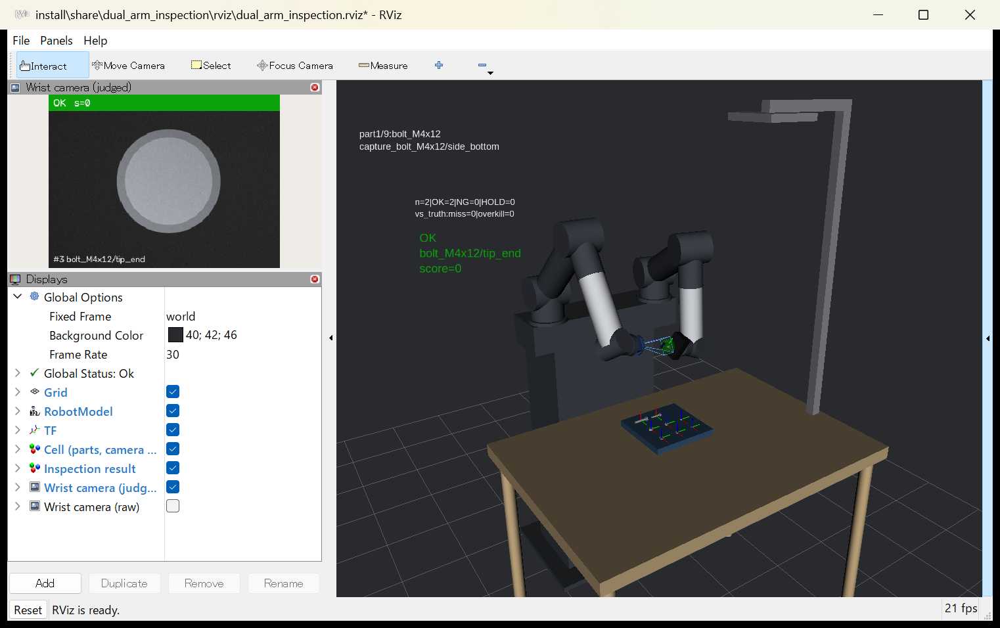
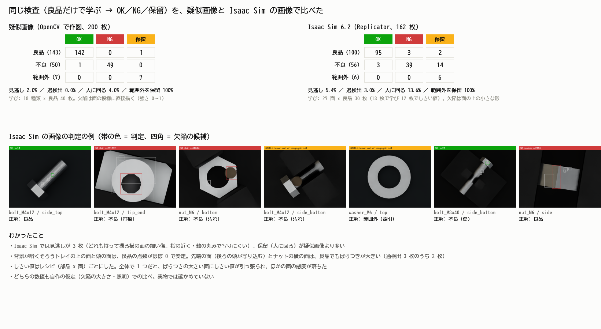
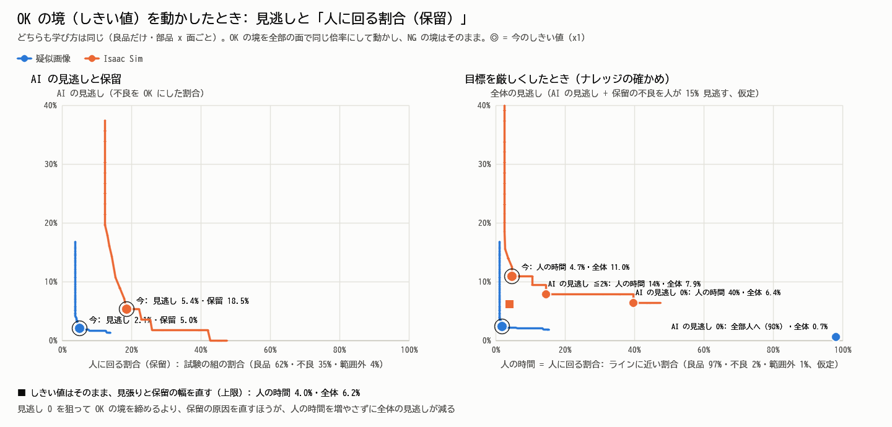

# ros2-learning

ROS 2 Jazzy を **Windows 11 にネイティブで** 入れて学ぶ記録です。WSL2 も Docker も使わず、[pixi](https://pixi.sh/) と [RoboStack](https://robostack.github.io/) で環境を作っています。

ゴールは、ROS 2 の基礎 → Isaac Sim との連携 → Isaac Lab での強化学習、まで進むことです。

> この方法を選んだ理由: Isaac Sim 6 の公式手順でも、Windows では pixi で入れる ROS 2 Jazzy が使われていて、WSL2 は非推奨になっている（[Isaac Sim: ROS 2 Installation](https://docs.isaacsim.omniverse.nvidia.com/latest/installation/install_ros.html)）。

## 見どころ



| 作ったもの | 中身 | 確かめた数字 |
|---|---|---|
| [双腕の外観検査セル](src/dual_arm_inspection) | 自作の 6 軸 × 2 の腕。左手が部品を持ち、右手の手首カメラで面ごとに撮って、良品だけで学ぶ 3 段判定（OK／NG／保留）にかける。RViz で動きと判定を見る | 動きの目標 65 点すべてで逆運動学が上下限の中で解けた／1 周 9,746 点で腕どうしの距離は最短 5.2 cm／疑似画像 200 枚で見逃し 2%・過検出 0%・範囲外の照明はすべて保留 |
| [稼働台帳 robot_ledger](src/robot_ledger) | ロボットの稼働を Ed25519 の署名とハッシュの鎖で記録し、使用範囲の中の仕事だけを数えて請求額を出す。双腕セルの検査 1 件ずつを台帳にし、工場の受け取りの署名がある分だけ請求する（[検査の台帳](#検査の台帳-双腕セルの判定を署名つきの台帳で数えるロボット--ai--ブロックチェーン)） | テスト 30 件／Isaac Sim の 162 件で、自動で決めた 132 件のうち受け取り済みの 121 件だけを請求、保留・範囲外の 30 件は数えない／セルが自分の鍵で作り直した台帳も見抜く |
| Windows ＋ Linux の環境 | Windows ネイティブの Jazzy（pixi）と、WSL2 の Ubuntu 22.04 ＋ Humble（[`tools/wsl_setup_humble.sh`](tools/wsl_setup_humble.sh)） | 詰まったことを原因から解決した記録（[LOG.md](LOG.md)） |

## 環境

| 項目 | 内容 |
|---|---|
| OS | Windows 11 Home |
| ROS 2 | Jazzy（RoboStack） |
| パッケージ管理 | pixi 0.81.0 |
| Python | 3.12 |
| GPU | RTX 4070（12GB） |
| Linux | WSL2 の Ubuntu 22.04 ＋ ROS 2 Humble（現場や OSS でよく使われる組み合わせ。2026-11-07 から） |

## 使い方

```powershell
# pixi を入れる（初回のみ）
winget install prefix-dev.pixi

# 環境を作る（初回は数分かかる）
pixi install

# 自作パッケージをビルド
pixi run build

# 2つのターミナルで実行
pixi run talker     # 0.5秒ごとに "Hello World: N" を送る
pixi run listener   # 受け取って表示する
```

サービス・パラメータ・launch:

```powershell
# サービス（2つの整数を足す）
pixi run cmd /c "call install\local_setup.bat && ros2 run py_pubsub add_server"
pixi run cmd /c "call install\local_setup.bat && ros2 run py_pubsub add_client 2 3"   # → 5

# launch で talker と listener をまとめて起動し、パラメータを渡す
pixi run cmd /c "call install\local_setup.bat && ros2 launch py_pubsub pubsub.launch.py greeting:=Konnichiwa period:=1.0"

# 動いている途中でパラメータを変える
pixi run ros2 param set /param_talker greeting Changed
```

アクション（時間のかかる仕事を頼み、途中経過を受け取る。取り消しもできる）:

```powershell
pixi run cmd /c "call install\local_setup.bat && ros2 run py_pubsub fibonacci_server"
pixi run cmd /c "call install\local_setup.bat && ros2 run py_pubsub fibonacci_client --ros-args -p order:=10"
# → 途中経過 [0, 1, 1]、[0, 1, 1, 2] … のあと、結果 [0, 1, 1, 2, 3, 5, 8, 13, 21, 34, 55]
pixi run cmd /c "call install\local_setup.bat && ros2 run py_pubsub fibonacci_client --ros-args -p order:=10 -p cancel_after:=1.2"
# → 1.2 秒で取り消し、[0, 1, 1, 2, 3] で止まる
```

C++ のノードと turtlesim:

```powershell
pixi run talker_cpp          # C++ の talker（先に vcrt_local が動く。下の「Windows で詰まったこと」を参照）
pixi run turtlesim           # 亀の画面を開く
pixi run turtle_draw         # 亀に「F」の字を描かせる（別のターミナルで）
pixi run check_turtle_draw   # turtlesim を起動せずに、亀を動かす制御だけを確かめる
```


亀の位置（`/turtle1/pose`）を見ながら、次の点との距離と向きのずれに比例して速度（`/turtle1/cmd_vel`）を決める（P 制御）。5 つの点すべてに誤差 0.05 以内で着いた。

### ロボット × ブロックチェーン: 稼働台帳（robot_ledger）

ロボットの仕事を「**署名つき・ハッシュでつないだ台帳**」に記録し、**使用範囲の中で終わった仕事だけを数えて請求額を出す**。ブロックチェーンの芯（ID・署名・追記だけの鎖）を、小さく自分で作った練習。

```powershell
pixi run turtlesim                                                                      # 1. 亀の画面
pixi run cmd /c "call install\local_setup.bat && ros2 run robot_ledger ledger_recorder"  # 2. 台帳に記録するノード
pixi run turtle_draw                                                                    # 3. 亀が「F」を描く（仕事をする）
# 4. 台帳を確かめる → 請求額を出す
pixi run cmd /c "call install\local_setup.bat && ros2 run robot_ledger ledger_verify ledger/turtle1.jsonl --pubkey-file ledger/turtle1.pub"
pixi run cmd /c "call install\local_setup.bat && ros2 run robot_ledger ledger_bill ledger/turtle1.jsonl --pubkey-file ledger/turtle1.pub --price 100 --max-error 0.05"
```

| しくみ | 中身 |
|---|---|
| ID | ロボットごとの Ed25519 の鍵。公開鍵のハッシュがロボットの ID（例: `robot:ac155ef6283cf4e9`） |
| 署名 | 1行ずつロボットの秘密鍵で署名。秘密鍵（`ledger/*.key`）は Git に入れない |
| ハッシュの鎖 | 各行に1つ前の行のハッシュ。途中を書き換えるとつながらなくなる |
| 請求 | 登録された公開鍵で台帳を確かめてから、契約の「使用範囲」（誤差の上限）の中の仕事だけを数える |

結果（2026-11-05）:
- 亀が5つの点で仕事をし、台帳は7行（開始・仕事5件・終了）。確認は **OK**
- 契約「1件100円・誤差0.05以内」→ **5件・500円**。「誤差0.046以内」に厳しくすると **3件・300円**（2件は範囲の外）
- 台帳の1か所（点2の誤差 0.048 → 0.001）を書き換えると、**「中身が書き換えられている」で NG**、請求も拒否
- テスト12件（書き換え・削除・ハッシュの計算し直し・別の鍵で作った偽の台帳・請求）: `python -m pytest src/robot_ledger/test`

まだないもの: 何社もで台帳を持ち合う仕組み（合意）、公開のブロックチェーンへの記録、支払い。受け取る側（工場）の署名は、下の「検査の台帳」で足した。

### 双腕の外観検査セル（dual_arm_inspection）

**左腕が部品を持って見せ、右腕の手首カメラで面を順に撮り、OK／NG／保留の 3 段で判定する**シミュレーション。ロボットは自作の簡単な形（胴体 + 6 軸の腕 2 本、逆運動学は式で解く）。部品は synthetic-testbench と同じボルト・ナット・座金（9 個、27 面）。

```powershell
pixi run build
pixi run dual_arm          # robot_state_publisher + セルの動き + 疑似カメラ + 検査 + RViz
pixi run check_dual_arm    # GUI なしで確かめる（逆運動学・腕どうしの距離・検査の当たり外れ）→ docs/dual_arm_inspection.png
pixi run test_dual_arm     # pytest
```


| ノード | すること |
|---|---|
| `cell_node` | 決めた順番（トレイの上の面を撮る → 取る → カメラの前に出す → 面を変える → 戻す）を逆運動学で関節角にし、`/joint_states` を 30Hz で出す。部品の TF は持っている間 `l_tcp` の子になる |
| `camera_node` | 撮る合図ごとに、部品の面の画像を OpenCV で作る（傷・打痕・汚れ、照明のばらつき、ときどき範囲外の照明）。`sensor_msgs/Image`（rgb8）を自分で詰める |
| `inspector_node` | 起動時に**良品の画像だけで**「ふつうの見え方」としきい値を学び、OK（自動で通す）／NG（自動で弾く）／保留（人に回す）で判定。明るさや背景が学んだ範囲から外れたら、点数に関係なく保留（範囲外の見張り） |

結果（2026-11-06、`check_dual_arm`）:
- 逆運動学: 動きの目標 65 個すべて解けて上下限の中（手先の誤差 最大 1e-15）。でたらめな関節角 2000 通り × 2 腕の解き直しも全部戻った
- 1 周 195 秒を 50Hz で刻んだ 9,746 点: 上下限の外 0、腕どうしの最短 0.052 m（下限 0.03 m）、机・胴体・照明との最短 0.050 m
- 検査（疑似画像 200 枚）: 良品 143 → OK 142・保留 1 ／ 不良 50 → NG 49・OK 1（見逃し: 強さ 0.00 のごく薄い傷）／ 範囲外 7 → すべて保留

数値は自作の疑似画像での結果で、欠陥の強さや照明の仮定で変わる（実物では未検証）。

**Isaac Sim 6.2 でも撮った（2026-11-07）。** 同じ関節角で右手首の Replicator カメラから撮り、Isaac Sim の良品だけで学び直して同じ検査で判定した（手順: [`src/dual_arm_inspection/isaac`](src/dual_arm_inspection/isaac/README.md)）。

```powershell
C:\isaacsim\python.bat src\dual_arm_inspection\isaac\capture_inspection.py --no-ros-env --width 480 --height 360 --good-out src\dual_arm_inspection\isaac\out\good --good-repeat 30 --test-out src\dual_arm_inspection\isaac\out\test --test-repeat 6 --defects 0.4 --p-ood 0.05 --seed 2
pixi run isaac_figure
```

| | 疑似画像（200 枚） | Isaac Sim（162 枚） |
|---|---|---|
| 見逃し | 2.0% | 5.4% |
| 過検出 | 0.0% | 3.0% |
| 人に回る（保留） | 4.0% | 18.5% |
| 範囲外を保留 | 7 / 7 | 6 / 6 |

- 良品 810 枚 + 欠陥あり 162 枚を 136 秒（起動を含む）、GPU のメモリはパソコン全体で最大 3.1GB（RTX 4070、480x360、画面なし）
- 自作の運動学のカメラ位置と Isaac Sim のカメラ位置の差: 972 枚すべて 1mm 以下



**保留 18.5% の内訳と、見逃しの曲線（2026-11-07）。** 欠陥の大きさ（mm）と濃さ（%）という同じ物差しで、疑似画像と Isaac Sim を比べた（`pixi run python src/dual_arm_inspection/isaac/analyze_miss_curve.py`、約 40 秒。詳しくは [isaac の README](src/dual_arm_inspection/isaac/README.md)）。

- 保留 30 枚 = 範囲外の照明 6（ねらいどおり）＋ **不良が形・明るさの見張りに当たった 13**（濃い汚れ・打痕）＋ 点数があいまいな不良 8（うち 5 は写り込みのあるボルトの先端の面）＋ 良品 3
- 見逃しは、どちらも濃さ 20% 未満の薄い傷だけ。濃さ 20% 以上の不良は Isaac Sim で 0/45（95% の幅 0〜7.9%）
- 見逃し 0 を狙って OK の境を締めると、人の時間は 4.7% → 39.7%（ラインに近い割合の仮定）。しきい値はそのままで見張りと保留の幅を直すと 4.0% のまま、全体の見逃しも 11.0% → 6.2%（上限の見積もり、人の見逃し 15% の仮定）



確認用のコマンド:

```powershell
pixi run ros2 node list         # /minimal_publisher, /minimal_subscriber
pixi run ros2 topic info /topic # Publisher 1 / Subscription 1
pixi run ros2 topic hz /topic   # 約 2Hz
```

### 検査の台帳: 双腕セルの判定を、署名つきの台帳で数える（ロボット × AI × ブロックチェーン）

双腕セルの検査（AI の 3 段判定）を 1 件ずつ**検査セルの鍵で署名した台帳の行**にし、**使用範囲書**（何を数えるかの約束）と**工場の受け取りの署名**で請求額を出す。お金・登録・ネットワークは使わない。

```powershell
pixi run inspection_ledger_demo   # Isaac Sim 162 件・疑似画像 200 件 → 台帳 → 請求 → 改ざんの見抜き → peaq の形（出力は ledger/inspection_demo/、Git に入れない）
pixi run test_ledger              # pytest（稼働台帳 12 件 + 検査の台帳 18 件）
# ROS 2 で: 検査セルを動かしながら、/inspection/result を台帳に書く（先に pixi run build と pixi run dual_arm）
pixi run cmd /c "call install\local_setup.bat && ros2 run robot_ledger inspection_recorder"
```

| しくみ | 中身 |
|---|---|
| 台帳の 1 行 | 検査 1 件: セルの ID（公開鍵）・部品・面・判定（OK／NG／保留）・点数・しきい値の版・範囲内か・画像の SHA-256（画像そのものは入れない）・時刻・前の行のハッシュ。正解（本当に不良か）はセルにはわからないので入れない |
| 使用範囲書 | 数えるのは「範囲内で AI が自分で決めた分（OK／NG）」だけ。保留（人に回した分）・範囲外・しきい値の版が違う分・対象外の部品は数えない。後から見つかった見逃し（1 件 1,000 円）・過検出（1 件 100 円）の減額と、申し立ての期限（30 日）も書く。指紋を台帳の先頭の行と工場の受け取りに入れ、同じ約束だと示す |
| 2 者の署名 | 工場が 50 件ずつのまとまりに受け取りの署名（まとまりの最後の行のハッシュを入れる）をする。署名がない分は数えない。信頼する鍵の一覧（セルと工場の公開鍵）で両方の台帳を確かめる |
| peaq の形 | 台帳の行を Verifiable Storage の封筒（`peaq-ipfs-envelope@v1`）と peaqOS のイベントの JSON に書き出し、公式の確かめ方（challenge を作り直して ed25519 で確かめる・イベントの欄の決まり・dataHash = keccak256）でテストする。テストネットには送らない |

結果（2026-11-07。料金は 1 件 100 円の見本で、お金は動かさない）:

| 撮り方 | 全件 | 範囲内で AI が決めた（OK／NG） | 保留（人へ） | 範囲外（人へ） | 受け取り待ち | 請求した件数 | 小計 | 見逃し・過検出の減額 | 差し引き |
|---|---|---|---|---|---|---|---|---|---|
| Isaac Sim の画像 | 162 | 132 | 10 | 20 | 11 | 121（OK 88・NG 33） | 12,100 円 | 3,300 円（見逃し 3・過検出 3） | 8,800 円 |
| 疑似画像 | 200 | 192 | 1 | 7 | 49 | 143（OK 105・NG 38） | 14,300 円 | 1,000 円（見逃し 1） | 13,300 円 |

- Isaac Sim: **自動で決めた 132 件のうち、工場が受け取った 121 件だけを請求。保留 10 件と範囲外 20 件は人に回したので数えない。** 範囲外は、セルが自分で「学んだ範囲の外」と判断した数（部品の面積 11・明るさと背景 9）で、本当に照明を変えた 6 枚より多い
- 受け取り待ち: 工場は最後のまとまり（seq 151〜）にまだ署名していない、という設定。署名すると Isaac Sim は +11 件、疑似画像は +49 件になる
- 見逃し・過検出は、シミュレーションの正解で「後の工程で見つかった」ことにして、工場が申し立てた（正解は台帳には入れていない）
- 改ざん: 保留の 1 行を OK に書き換える → **請求を拒否**（ハッシュが合わない）。**検査セルが自分の鍵で台帳を丸ごと作り直す**と、セルの鍵の確認は通ってしまうが、**工場の受け取りの署名と合わず請求を拒否**（1 者の署名では防げない所を、2 者の署名で防ぐ）
- peaq の形: 封筒 364 個・イベント 364 個（活動 362・売上 2）が、すべて公式の確かめ方に合った。書き換えた 1 行は、封筒との照らし合わせでも見抜けた
- ROS 2: 検査セル（RViz なし）と `inspection_recorder` を 90 秒動かし、35 件を台帳に書いた → 確認 OK。受け取りの署名のあと、30 件（OK 21・NG 9）を数えた（保留 1・範囲外 4 は数えない）

公式の資料に書かれていない所（封筒の `createdAt` の形式、`robotId` に DID の代わりに台帳の ID を入れた、`dataCid` は手元で計算した仮）は、[`peaq_format.py`](src/robot_ledger/robot_ledger/peaq_format.py) の先頭に書いた。

## 中身

| パス | 内容 |
|---|---|
| [`src/py_pubsub`](src/py_pubsub) | Python のパブリッシャー・サブスクライバー、サービス、パラメータ、launch、tf2、rosbag2、アクション（公式チュートリアル）と、亀に字を書かせるノード |
| [`src/robot_ledger`](src/robot_ledger) | ロボットの稼働を署名つきの台帳に記録し、使用範囲の中の仕事だけを数えて請求額を出す（ロボット × ブロックチェーンの練習） |
| [`src/dual_arm_inspection`](src/dual_arm_inspection) | 双腕の外観検査セル（xacro・逆運動学・動きの計画・疑似カメラ・3 段判定・RViz の設定・Isaac Sim の下書き） |
| [`tools/check_dual_arm.py`](tools/check_dual_arm.py) | 双腕セルを GUI なしで確かめ、1 枚の絵にまとめる |
| [`tools/inspection_ledger_demo.py`](tools/inspection_ledger_demo.py) | 検査の台帳の通しの見本（台帳 → 工場の受け取り → 請求 → 改ざんの見抜き → peaq の形） |
| [`tools/vcrt_local.py`](tools/vcrt_local.py) | Windows の Visual C++ ランタイムが古いとき、新しいランタイムを C++ の exe の隣に置く（管理者権限なし） |
| [`tools/check_turtle_draw.py`](tools/check_turtle_draw.py) | 亀を動かす制御を、turtlesim と同じ動きの式で確かめる |
| [`pixi.toml`](pixi.toml) | 環境と実行コマンドの定義 |
| [`LOG.md`](LOG.md) | 日ごとの学習記録（やったこと・詰まったこと・解決策） |

## Windows で詰まったこと

| 症状 | 原因 | 対処 |
|---|---|---|
| colcon のビルドで `UnicodeDecodeError: 'cp932'` | 日本語を含むファイルを、Windows の標準の文字コードで読もうとする | `PYTHONUTF8=1`（`pixi.toml` で設定済み） |
| C++ のノードが起動してすぐ落ちる（`0xC0000005`） | Windows に入っている Visual C++ ランタイムが古い（この PC は 2019 年の 14.2x） | Visual C++ 再頒布可能パッケージを最新にする（この PC はこれで直った）。管理者の許可がもらえないときは `pixi run vcrt_local`（環境の新しいランタイムを exe の隣に置く） |
| 「アプリケーション制御ポリシーによってこのファイルがブロックされました」 | Windows 11 の**スマート アプリ コントロール**が、署名がなく評判のわからない exe や DLL を止める（この PC では turtlesim の本体と、その型の DLL） | スマート アプリ コントロールをオフにする（Windows セキュリティ → アプリとブラウザー コントロール。この PC はオフにして turtlesim が動いた）。オンのままでは、止められたパッケージは使えない。イベントログ `CodeIntegrity/Operational` の ID 3077 で、止められたファイルがわかる |

## 進み具合

- [x] Windows に ROS 2 Jazzy を入れる（pixi / RoboStack）
- [x] デモのノードを動かし、ノードとトピックを確認する
- [x] Python でパブリッシャーとサブスクライバーを書く
- [x] サービスとパラメータ
- [x] launch ファイル
- [x] tf2: 座標変換を送る・受け取る（ロボットとカメラの位置関係）
- [x] rosbag2: ノードの中から記録して、再生する
- [x] C++ のノードを動かす（古い Visual C++ ランタイムを避ける）
- [x] アクション: 時間のかかる仕事を頼み、途中経過を受け取り、取り消す
- [x] turtlesim で移動ロボットを動かす（亀に「F」の字を描かせる。位置を見ながら速度を決める P 制御）
- [x] ロボット × ブロックチェーン: 稼働を署名つきの台帳に記録し、働いた分だけ請求する（robot_ledger）
- [x] 双腕の外観検査セル: xacro のロボット・逆運動学・RViz・疑似カメラ・3 段判定（dual_arm_inspection）
- [x] 双腕セルを Isaac Sim で撮り、同じ検査で判定して疑似画像と比べる（`src/dual_arm_inspection/isaac`）
- [x] 検査の台帳: 双腕セルの判定を署名つきの台帳にし、工場の受け取りの署名と使用範囲書で請求額を出す。peaq の記録の形に書き出す
- [ ] 台帳を Isaac Sim のロボット（Franka）にもつなぐ
- [ ] Isaac Sim × ROS 2（公式の `IsaacSim-ros_workspaces` に移る）
- [ ] Isaac Lab で強化学習

## ライセンス

Apache-2.0
