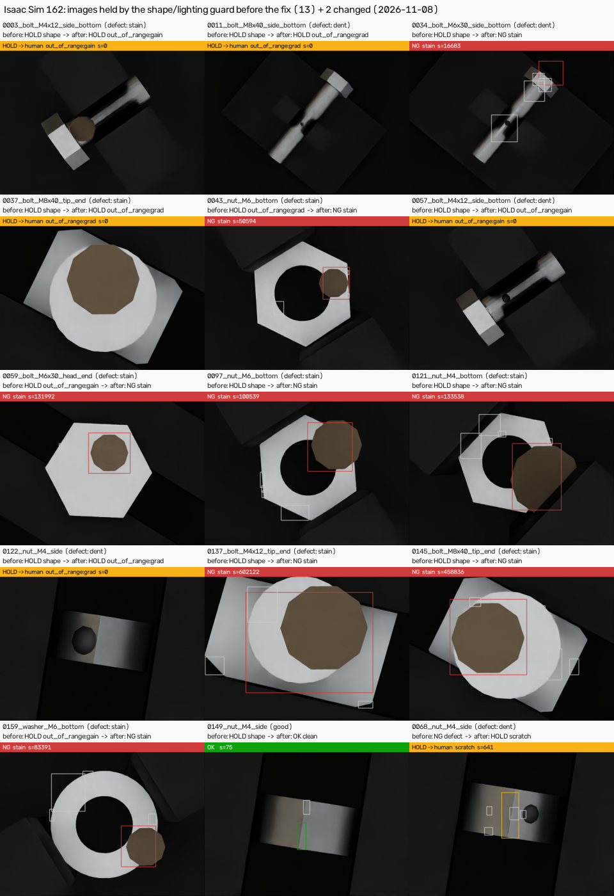
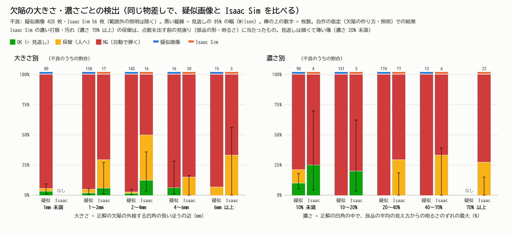
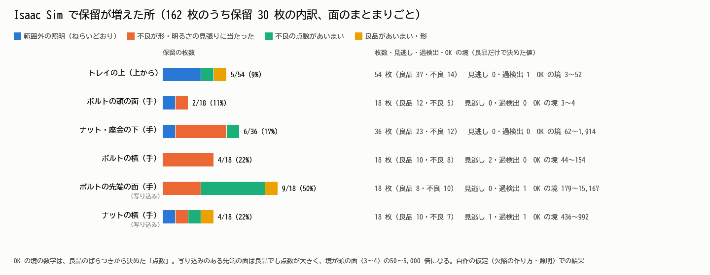
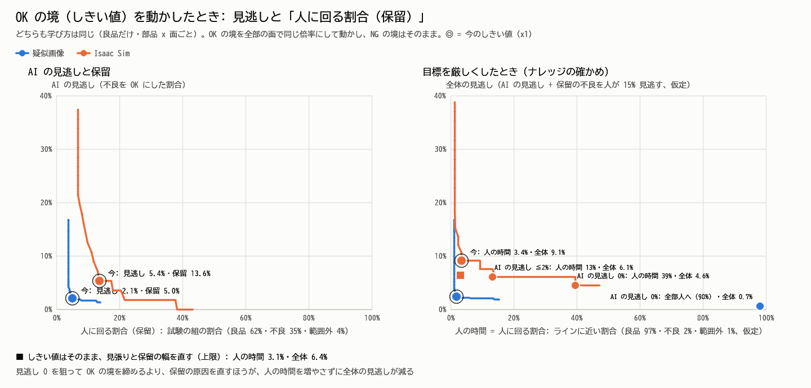
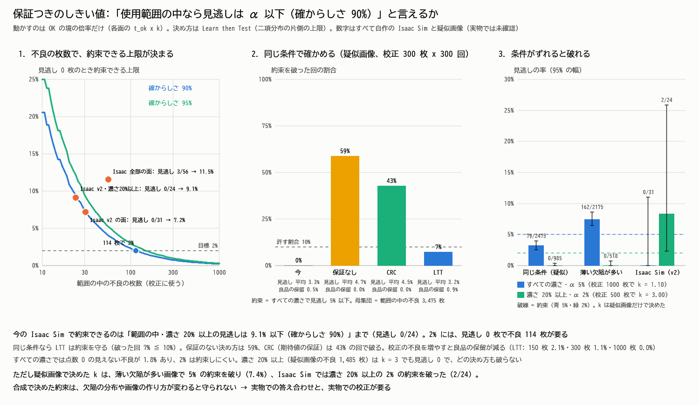
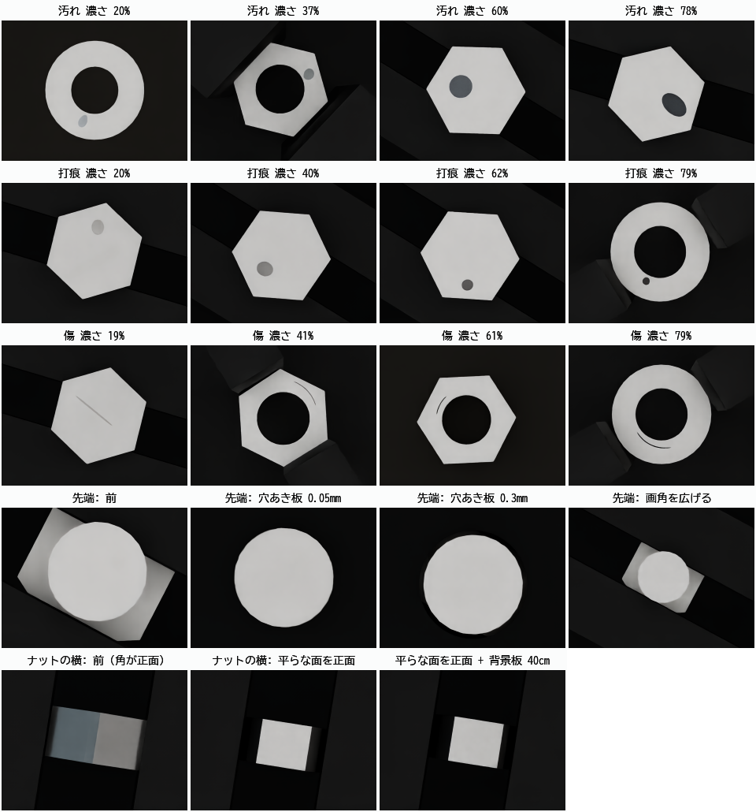

# 2 段目: 双腕セルを Isaac Sim 6.2 で撮って、同じ検査で判定する

> **状態: 2026-11-07 に動いた。** Windows 11・RTX 4070（12GB）・Isaac Sim 6.2.0 で、画面なし（headless）・480x360。
> 良品 810 枚と欠陥あり 162 枚を撮り、ROS 2 側と同じ検査（`inspection.py`、良品だけで学ぶ → OK／NG／保留）で判定した。
> 2026-11-08 に「範囲外の見張り」を直し（下の「見張りの直し」）、人に回る割合は 18.5% → 13.6%（見逃し・過検出はそのまま）。
> 2026-11-08 に範囲の中の 3 面を、学ぶ用・しきい値を決める用・確かめる用に分けて 2,670 枚撮り直した（不良は面ごとに 54 枚・濃さ 10〜90%）。
> 写り込みの 2 面は、穴あき板と「平らな面を正面」で良品のばらつきが 0.11 → 0.012 になった（下の「使用範囲の中の撮り直し」）。

RViz で動かしているのと**同じ計画・同じ関節角**で、Isaac Sim の右手首カメラ（Replicator）から撮ります。

```
pixi（ROS 2 の環境）                      Isaac Sim 6.2 の Python（C:\isaacsim\python.bat）
──────────────────────                  ────────────────────────────────────────
export_urdf.py                           capture_inspection.py
  xacro → dual_arm.urdf（机などなし）  →    URDF → USD（初回だけ。2 回目からは使い回す）
  planner → inspection_plan.json      →    関節角を入れる・部品を置く・黒い背景板・欠陥を出す
                                           右手首のカメラ + リング照明 → Replicator で撮る
judge_folder.py / make_compare_figure.py ← out\good\ と out\test\（PNG + shots.json）
  Isaac の良品だけで学び直す → 表と絵（docs\isaac_vs_synthetic.png）
```

## 藤田さんが自分で動かすコマンド

```powershell
cd C:\Users\yousa\dev\ros2-learning
pixi run dual_arm_urdf
C:\isaacsim\python.bat src\dual_arm_inspection\isaac\capture_inspection.py --no-ros-env --width 480 --height 360 --good-out src\dual_arm_inspection\isaac\out\good --good-repeat 30 --test-out src\dual_arm_inspection\isaac\out\test --test-repeat 6 --defects 0.4 --p-ood 0.05 --seed 2
pixi run isaac_figure
```

- 2 行目（撮る）: 良品 27 面 x 30 周 = 810 枚と、欠陥あり 27 面 x 6 周 = 162 枚を、1 回の起動で撮る
- 3 行目: Isaac Sim の良品だけで学び直して判定し（`isaac_judge`）、比べの絵を `docs\isaac_vs_synthetic.png` と `docs\isaac_shots.png` に作る
- まず試すだけなら: `... capture_inspection.py --no-ros-env --max-shots 3 --good-only --width 480 --height 360 --out src\dual_arm_inspection\isaac\out\try`
- `out\` は Git に入れない（`.gitignore` 済み）

## かかった時間と GPU のメモリ（2026-11-07）

| 場面 | 時間 | GPU のメモリの最大 |
|---|---|---|
| はじめての起動（シェーダーの準備、藤田さんの実行） | 約 135 秒で起動 | — |
| 2 回目からの起動 | 約 8 秒で起動 | — |
| 3 枚 | 13 秒（起動から終わりまで） | 3,020 MiB |
| 良品 810 枚 + 欠陥あり 162 枚 | 136 秒 | 3,077 MiB |
| 欠陥あり 162 枚だけ | 31 秒 | 3,038 MiB |

GPU のメモリはパソコン全体の値です（Isaac Sim を動かす前に、ほかのアプリで約 1.2GB 使っていた）。12GB の 4 分の 1 くらいで足りました。

## 結果（疑似画像との比べ）

| | 疑似画像（200 枚） | Isaac Sim（162 枚） |
|---|---|---|
| 良品 → OK／NG／保留 | 142 ／ 0 ／ 1 | 95 ／ 3 ／ 2 |
| 不良 → OK／NG／保留 | 1 ／ 49 ／ 0 | 3 ／ 39 ／ 14 |
| 範囲外 → 保留 | 7 ／ 7 | 6 ／ 6 |
| 見逃し | 2.0% | 5.4% |
| 過検出 | 0.0% | 3.0% |
| 人に回る（保留） | 4.0% | 13.6% |
| 自動で決めた分の正解率 | 99.5% | 95.7% |

（2026-11-08 の見張りの直しのあとの数字。直す前は Isaac Sim が 94／3／3・3／32／21・保留 18.5%・正解率 95.5%）

- 自作の運動学で計算したカメラの位置と、Isaac Sim に読み込んだロボットのカメラの位置の差: 972 枚すべて 1mm 以下（最大 0.005mm）
- Isaac Sim の見逃し 3 枚は、どれも持って撮る横の面の細い傷。過検出 3 枚のうち 2 枚は、後ろの頭が写り込む先端の面と、ナットの横の面
- どちらも自作の仮定（欠陥の大きさ・照明）での比べです。実物では確かめていません

## 見張りの直し（2026-11-08、瞳）: 部品の面積 → 学んだ形との差

保留 30 枚のうち 13 枚は、濃い汚れ 9・打痕 4 なのに「範囲外（形・明るさ）」で人に回っていた。黒い汚れが縁にかかると、
大津の二値化で部品が欠けて面積が 15% 以上減り、「形が変わった」と誤解していたため。`inspection.py` を次のように直した。

1. **形の見張りを「面積」から「学んだ形との差」に。** 位置を合わせたあと、学んだ形（良品 18 枚が全部で一致した所）と比べて、
   **欠けた所**（形の中なのに暗い）と**はみ出た所**（形の外なのに明るい）を分けて測る。欠けは濃い汚れ・打痕の候補なので点数へ回し、
   はみ出し（指・隣の部品）は良品で学んだ範囲（`extra`）で見張る。欠けが 6 割を超えたときだけ「形」で範囲外（部品が違う・見切れ）
2. **欠けて重心がずれたら、学んだ形に合わせ直す。** 残った明るい所が形にいちばん収まる位置へ、相互相関（`cv2.matchTemplate`）で
   ずらし直す（`refine_align`）。欠けが 2% 未満の良品では動かないので、良品の判定は変わらない。向きは変えない（指も写る面では
   向きまで合わせ直すとかえってずれた）
3. **明るさの平面は、欠けた所とそのぼけた縁（3 画素）を除いて当てはめる。** 濃い欠陥に引っ張られて「暗くなった」と誤解しないため



| | 直す前（Isaac Sim 162 枚） | 直した後 | | 直す前（疑似画像 200 枚） | 直した後 |
|---|---|---|---|---|---|
| 良品 100 → OK／NG／保留 | 94／3／3（形 1・あいまい 2） | 95／3／2（形 0・あいまい 2） | 良品 143 | 142／0／1（あいまい 1） | 同じ |
| 不良 56 → OK／NG／保留 | 3／32／21（形 10・照明 3・あいまい 8） | 3／39／14（形 0・照明 5・あいまい 9） | 不良 50 | 1／49／0 | 同じ |
| 範囲外 6 → 保留 | 6（照明 6） | 6（照明 6） | 範囲外 7 | 7（照明 6・形 1） | 7（照明 7） |
| 見逃し／過検出／保留 | 5.4%／3.0%／18.5% | 5.4%／3.0%／**13.6%** | | 2.0%／0.0%／4.0% | 同じ |

- 13 枚のうち **8 枚が NG**（汚れ 7・打痕 1。点数は OK の境の 100〜50,000 倍）。**5 枚はまだ保留**だが理由は「形」ではなく明るさの見張り
  （倍率 2・傾き 3）。この 5 枚は部品の 9〜32% が暗く欠けていて、残った所だけでは照明の倍率・傾きを正しく測れない
  （ボルトの横を手で持つ面 3 枚は、打痕で軸が 2 つに切れ、頭しか切り出せない）。照明の見張りは範囲外の照明（疑似画像の外光は欠け 19%）を
  捕まえるのに要るので、ここでは外していない
- 良品で「形」の保留だった 1 枚（ナットの横、指のはみ出し 48%）は、その面の良品で学んだはみ出しの範囲の中なので OK になった
- 不良 1 枚（ナットの横の打痕）は NG → 保留（あいまい）になった。前の点数 3,722 は欠けによる位置ずれ込みで、合わせ直した点数 641 が
  その面の OK の境 436 と NG の境 1,309 の間に入ったため
- 使用範囲の案（下）の中では、AI が自分で決めた枚数が 95 → 100 枚（58.6% → 61.7%）。範囲の中の見逃し 0/31・過検出 1/72 は同じ
- 試して効かなかったこと（課題 3、細い傷の見逃し 3 枚）: 上位 3 つのまとまりの合計・細長いまとまりの合計・線の形の閉じ処理（7・11 画素）
  のどれも見逃しを減らさなかった（合計にすると良品の点数も上がって OK の境が上がり、見逃し 3 → 5・4 枚に増えた）。
  見逃しの 1 枚（ナットの横）は点数 3〜4 で OK の境 436〜447 の 1% 以下。点数の出し方では届かず、写り込みを減らす撮り方か面の使用範囲の話
- 確かめ方: `pixi run test_dual_arm`（見張りのテスト 6 件を追加）、`pixi run isaac_figure`（この表）、`analyze_miss_curve.py`（面ごとの内訳）

## 見逃しの曲線と保留の内訳（2026-11-07）

```powershell
pixi run python src/dual_arm_inspection/isaac/analyze_miss_curve.py   # 約 40 秒。--reuse で判定し直さずに表と絵だけ
```

Isaac Sim の 162 枚と疑似画像 1,200 枚（曲線用に別に作る）を、**同じ物差し**で比べた。物差しは検査のしきい値に関係しない:
- 大きさ: 正解の欠陥の外接する四角の長いほうの辺（mm。倍率は撮るときのレシピの値）
- 濃さ: 正解の四角の中で、良品の平均の見え方からの明るさのずれの最大（%）



| 濃さ | 疑似画像: 見逃し | Isaac Sim: 見逃し・保留 |
|---|---|---|
| 10% 未満 | 10.0%（9/90、95% の幅 5.4〜17.9%） | 1/4・0% |
| 10〜20% | 0/151 | 1/5・0% |
| 20% 以上 | 0/187（95% の幅 0〜2.0%） | **0/45（95% の幅 0〜7.9%）**・保留 44%（20/45） |

- 見逃しは、どちらも**薄い欠陥（濃さ 20% 未満）だけ**。Isaac Sim の見逃し 3 枚は細い傷（ボルトの横を手で持って撮る面 2、ナットの横 1）。大きさ（mm）では差がはっきりしない
- Isaac Sim の打痕・汚れは濃さが 87〜96%（中央値）と、疑似画像（21〜22%）よりずっと濃い。欠陥の作り方の差（暗い球・茶色の円盤 vs 反射率を少し下げる）



| 面 | 枚数 | 保留 | 内訳（照明・見張り・不良あいまい・良品） | 見逃し | 過検出 | OK の境 |
|---|---|---|---|---|---|---|
| トレイの上（上から） | 54 | 5 | 3・0・1・1 | 0/14 | 1/37 | 3〜52 |
| ボルトの頭の面（手） | 18 | 2 | 1・1・0・0 | 0/5 | 0/12 | 3〜4 |
| ナット・座金の下（手） | 36 | 6 | 1・4・1・0 | 0/12 | 0/23 | 62〜1,914 |
| ボルトの横（手） | 18 | 4 | 0・4・0・0 | 2/8 | 0/10 | 44〜154 |
| ボルトの先端の面（手、写り込み） | 18 | **9** | 0・3・5・1 | 0/10 | 1/8 | 179〜15,167 |
| ナットの横（手、写り込み） | 18 | 4 | 1・1・1・1 | 1/7 | 1/10 | 436〜992 |

- **保留 30 枚の内訳: 範囲外の照明 6（ねらいどおり）、不良が形・明るさの見張りに当たった 13、点数があいまいな不良 8、良品 3。** 見張りに当たった 13 枚は濃い汚れ 9・打痕 4 で、部品の切り出しの面積が 15% 以上変わった（10 枚）か、明るさの当てはめがずれた（3 枚）。点数を出す前に「範囲外」として人に回っている
- 点数があいまいな不良 8 枚のうち 5 枚は、写り込みのあるボルトの先端の面。良品の点数が大きいので OK の境が 179〜15,167 と、頭の面（3〜4）の 50〜5,000 倍になり、傷が保留の帯に入る
- 照明（範囲の中の ±10%）: 保留は暗め 6%（2/33）・ふつう 16%（12/76）・明るめ 21%（10/47）。明るいほど多い傾向はあるが、幅が重なっていて言い切れない
- 学ぶ枚数の差（疑似画像 20+20 枚、Isaac Sim 18+12 枚）: 疑似画像を 18+12 枚で学び直すと保留 4.1% → 5.0%（見逃しは 2.0% のまま）。差の大部分ではない
- 良品のばらつき σ の 95 パーセンタイル: 疑似画像は最大 0.032、Isaac Sim は最大 0.140（ボルトの横を手で持つ面・ナットの横・先端の面）



| ここを直したら（同じ画像・同じ点数で決め方だけ変える） | 見逃し | 過検出 | 保留（試験の組） | 人の時間（ライン） | 全体の見逃し |
|---|---|---|---|---|---|
| 今のまま（2026-11-07） | 5.4% | 3.0% | 18.5% | 4.7% | 11.0% |
| 保留の幅を 3 倍 → 2 倍 | 5.4% | 3.0% | 15.4% | 4.5% | 9.6% |
| 見張りが不良に反応しないよう直せたら（上限） | 5.4% | 3.0% | 10.5% | 4.2% | 7.5% |
| ↑ + 保留の幅 2 倍 | 5.4% | 3.0% | **7.4%** | 4.0% | 6.2% |
| OK の境を締めて AI の見逃し 0%（x0.008） | 0.0% | 3.0% | 42.6% | **39.7%** | 6.4% |
| **見張りを直した実測（2026-11-08）** | 5.4% | 3.0% | 13.6% | 3.4% | 9.1% |

- 「人の時間」は良品 97%・不良 2%・範囲外 1% のラインを仮定した保留の割合。「全体の見逃し」は、保留に回った不良を人が 15% 見逃す仮定（ナレッジの「目視の見逃し 5〜30%」の真ん中くらい）
- **ナレッジの「AI に厳しすぎる目標は逆効果」は、この検査でも言える。** Isaac Sim で AI の見逃しを 5.4% → 3.6% → 1.8% → 0% と締めると、人の時間は 4.7% → 10.5% → 14.4% → 39.7%（8 倍）。全体の見逃しは 11.0% → 6.4% に下がるが、しきい値を変えずに保留の原因（見張り・保留の幅）を直すと、人の時間 4.0% のまま 6.2% になる（上限の見積もり）。疑似画像では点数 0 の不良があるため、見逃し 0 は「全部人に回す」（98%）しかない
- 「見張りを直したら」は、正解を見て不良だけを点数で判定し直した上限。保留の幅 2 倍は、この 100 枚の良品で過検出が増えなかっただけ（0/100 の 95% の幅は 0〜3.7%）

### 使用範囲の案（Isaac Sim の結果から。自作の仮定で、枚数が少ない）

| 条件 | 自動で決める（OK／NG） | 人に回す（保留） |
|---|---|---|
| 面 | トレイの上から撮る面、ボルトの頭の面、ナット・座金の下の面 | ボルトの先端の面・ナットの横（写り込み）、ボルトの横を手で持って撮る面 |
| 照明 | 明るさ・背景・明るさの傾き・部品の面積が、学んだ範囲の中 | 範囲の外（照明を変えた 6 枚は 6/6 を保留にできた） |
| 欠陥 | 検出を約束するのは濃さ 20% 以上（0/45 見逃し、95% の幅 0〜7.9%） | 濃さ 20% 未満の細い傷は約束しない |

- この範囲の中では、見逃し 0/31（95% の幅 0〜11.0%）・過検出 1/72（0.2〜7.5%）。AI が自分で決めたのは 162 枚のうち 95 枚（58.6%）
- 枚数が少ないので、幅はまだ広い。言い切るには、面ごとに不良が 50 枚ほど要る（0/50 で 95% の幅の上が約 7%）

## 保証つきのしきい値（2026-11-08、瞳）:「範囲の中なら見逃しは α 以下（確からしさ 90%）」

議論の結論（保管庫の `40_Projects/議論_次に挑む課題/結論.md`）で決めた主の課題の、最初の一歩。今のしきい値は良品だけで決めているので、
「見逃しが何%以下」とは言えない。そこで OK の境の倍率 k（各面の t_ok x k）だけを動かし、**Learn then Test**（Angelopoulos ほか 2021、
[arXiv:2110.01052](https://arxiv.org/abs/2110.01052)）で決めた。

- 校正の不良 n 枚で、k ごとの見逃しの枚数 m(k) を数える。m(k) は k について単調に増えるので、「P(Bin(n, α) ≦ m(k)) ≦ δ」を満たす
  一番ゆるい k を選べば、**P（本当の見逃しの率 ≦ α）≧ 1 − δ**。比べる相手は、保証のない決め方（校正の率 ≦ α）と
  Conformal Risk Control（[arXiv:2208.02814](https://arxiv.org/abs/2208.02814)、期待値で ≦ α）
- 前提は「校正の画像と、これから判定する画像が同じ条件」。範囲外の見張りと面の振り分けでそれを守り、外れたものは数えない
- 計算は `dual_arm_inspection/guarantee.py`（math だけ、新しいインストールなし）。`pixi run isaac_guarantee`（約 3 分）



**1. 今の Isaac Sim の画像で約束できる上限**（撮り直していない。e369f6b の見張りで判定）

| 範囲 | 不良 | 今の見逃し | 上限（確からしさ 90%） | 上限（95%） |
|---|---|---|---|---|
| v1 全部の面 | 56 | 3 | 11.5% | 13.3% |
| v2 の 3 つの面 | 31 | 0 | 7.2% | 9.2% |
| v2・濃さ 20% 以上（使用範囲書 v2 の約束） | 24 | 0 | **9.1%** | 11.7% |

- **2% は今のデータでは約束できない。** 見逃し 0 枚でも、言えるのは 1 − δ^(1/n) まで。2% には不良が **114 枚**（見逃し 1 枚なら 194 枚、
  確からしさ 95% なら 149 枚）要る
- v2 の面で 10% を約束するなら k = 1.151（今よりゆるめられる）で、範囲の中の保留は 2.9% → 1.9%

**2. 同じ条件なら守れるか**（疑似画像 8,000 枚の範囲の中の不良 3,475 枚を母集団にし、校正 300 枚を選んで k を決める。300 回）

| 決め方（すべての濃さで 5% を約束） | 約束を破った回 | 見逃し（平均） | 良品が人に回る割合 |
|---|---|---|---|
| 今の境（k = 1） | 0%（この母集団の見逃しは 3.3%） | 3.3% | 0.5% |
| 保証なし | **58.7%** | 4.7% | 0.0% |
| CRC（期待値の保証） | 42.7% | 4.5% | 0.0% |
| **LTT（確からしさ 90%）** | **7.3%（≦ 10%）** | 3.2% | 0.9% |

- LTT は約束を守った（校正 150・300・1,000 枚で、破った回 7.3%・5.0%・8.3%）。校正の不良を増やすほど、同じ約束で良品の保留が減る
  （2.1% → 1.1% → 0.0%）。CRC は平均では 5% 以下だが、1 回ごとには約半分で破る（期待値の保証なので、ねらいどおり）
- すべての濃さでは、点数 0（何も見つからない）の不良が 1.8% あるので、2% の約束はほぼできない（k = 0 = 全部人へ、になりやすい）
- 濃さ 20% 以上（1,485 枚）は k = 3 でも見逃し 0 で、2% の約束はどの決め方でも破らなかった

**3. 限界: 条件がずれると破れる**（疑似画像だけで決めた k を、そのまま使う）

| 約束 | 同じ条件（疑似） | 薄い欠陥が多い疑似画像 | Isaac Sim（v2） |
|---|---|---|---|
| すべての濃さ・5%（k = 1.096） | 79/2,475（3.2%） | **162/2,175（7.4%）破った** | 0/31 |
| 濃さ 20% 以上・2%（k = 3.000） | 0/985 | 0/518 | **2/24（8.3%）破った** |

- 欠陥の分布がずれると（濃さの中央値 17% → 11%）、すべての濃さの約束は破れた。濃さ 20% 以上に区切った約束は、この種類のずれでは守れた
- **画像の作り方がずれると（疑似画像 → Isaac Sim）、濃さ 20% 以上の約束も破れた。** 合成で決めた k は、実物ではさらに外れうる。
  k は、判定するのと同じ撮り方の画像で校正する。実物の答え合わせのあとは、実物の画像で校正し直す

**使用範囲書 v3 の案**: [`scope_v3_draft.json`](scope_v3_draft.json)。v2 と同じ欄（面・濃さ 20%）に、新しい欄の提案 `guarantee_proposal`
（約束する見逃しの率・確からしさ・校正の枚数・k・有効な条件・抜き取りの監査）を足した。今の値は「範囲の中・濃さ 20% 以上の見逃し 9.1% 以下
（確からしさ 90%、k = 1）」、目標は不良 114 枚のあとで 2%。監査は、わざと流す不良の見本 n 枚で、見逃しが P(Bin(n, 上限) ≧ m) ≦ 0.05 に
なったら版を止める（上限 2% なら 50 枚で 4 枚。`guarantee.audit_stop`）

## 使用範囲の中の撮り直し（2026-11-08、伊佐美）: 面ごとに不良 54 枚・濃さ 10〜90%・写り込みの 2 面

瞳の「保証つきのしきい値」（範囲の中なら見逃しは ◯% 以下、確からしさ ◯%）の材料。前の 162 枚では、範囲の中の不良が 31 枚しかなく、
打痕・汚れの濃さが 87〜96%（中央値）とほぼ黒だった。そこで、範囲の中の 3 面だけを、学ぶ用・しきい値を決める用・確かめる用に分けて撮り直した。

```powershell
cd C:\Users\yousa\dev\ros2-learning
C:\isaacsim\python.bat src\dual_arm_inspection\isaac\capture_inspection.py --no-ros-env --width 480 --height 360 --sets src\dual_arm_inspection\isaac\scope_sets.json --sets-root src\dual_arm_inspection\isaac\out\scope --seed 1108 --out src\dual_arm_inspection\isaac\out\scope
pixi run python src/dual_arm_inspection/isaac/summarize_scope.py --figure docs/isaac_scope_shots.png   # 数える（約 1 分）
```

- 撮る組は `scope_sets.json` に書いてある（1 回の起動で全部。`--only fit,calib` で一部だけ）。画像は `out\scope\<組>\`（Git に入れない）
- 欠陥の形は `defect_mesh.py`（numpy だけ。形が材料の上に乗るかを `test/test_defect_mesh.py` の 93 件で確かめる）

### 欠陥の作り方を変えた（濃さを決めて撮る）

| | 前（2026-11-07） | 今（2026-11-08） |
|---|---|---|
| 材質 | 暗い球・茶色の円盤・灰色の箱（部品と別の材質） | 部品と同じ亜鉛の金属。色だけを `(1 - ねらいの濃さ) ** gamma` 倍に暗くする |
| 濃さ | 打痕・汚れは 87〜96%（中央値）でほぼ黒 | ねらいを 10〜90% に振る（種類ごとに 18 本の等間隔の帯から 1 つずつ） |
| 大きさ | 部品によらず同じ（汚れ 半径 1.5〜3mm は M4 の座金の輪の幅 2.35mm より大きい） | 面の「材料の幅」s に比例: 汚れ 半径 0.22〜0.38s、打痕 半径 0.12〜0.22s、傷 長さ 0.7〜1.4s（ボルトの横は x2.5・輪は x1.6）・幅は 2.2 画素以上 |
| 形 | 平らな形を面に置く（円柱では縁が浮く） | 面に沿わせる: ボルトの横は円柱に巻きつけ、ナット・座金の輪は輪に沿って曲げる。打痕は浅いふくらみ（高さ 3〜6%） |
| 置き場所 | 材料のある所 | 穴・縁・頭とねじ先にかからない窓の中（s: 軸の半径・頭の対辺の半分・輪の幅など） |

gamma は試し撮り（範囲の中の 3 面で各 27 枚）で決めた。最初に全部 2.2 で撮ると、瞳の物差しの濃さは「1 − (1 − ねらい)^g」で
g が傷 1.04・打痕 1.46・汚れ 1.28 だった（打痕はふくらみの縁の陰、汚れは少し茶色の分だけ濃く出る）。そこで gamma を 2.2/g
（傷 2.1・打痕 1.5・汚れ 1.7）にした。

### 写り込みの 2 面の撮り方

- **ボルトの先端の面**: 先端の円の後ろに、それより大きい頭（と頭を持つ指）が写り、画面の端で見切れ方が毎回変わっていた。
  (a) 画角を広げて頭を見切れないようにする、(b) 軸を通す黒い穴あき板（先端から 1.5mm、穴のすき間 0.05mm）、(c) 同じ板ですき間 0.3mm、を比べた
- **ナットの横**: 角をカメラに向けていたので、両側の平らな面（±30 度）が横の机（木の色）や腕を映し、少し回るだけで明るさが変わっていた。
  (a) 部品を軸のまわりに 30 度回して平らな面を正面に向ける（両側の面は ±60 度になり、後ろの黒い板を映して暗くなる）、(b) それに加えて背景板を 16cm → 40cm、を比べた
- どの撮り方も、同じ欠陥の作り方（濃さ 10〜90%）で、学ぶ用の良品 30 枚/レシピ ＋ 試験 60 枚（良品 30・不良 30）を撮り、今の検査（e369f6b の `inspection.py`）の保留の割合で比べた



### 撮った枚数と条件（2026-11-08、1 回の起動）

| 組 | フォルダ（`out\scope\`） | 面（レシピ） | 良品 | 不良 | 範囲外の照明 | 使い方 |
|---|---|---|---|---|---|---|
| 学ぶ用 | `fit` | 範囲の中の 3 面（18） | 540（30/レシピ） | — | — | 平均の見え方・ばらつき・見張りの範囲。今の検査は 18 枚で学び、残り 12 枚で今の境（t_ok） |
| しきい値を決める用 | `calib` | 同じ | 360（20/レシピ） | 162（面ごとに 54 = 打痕・傷・汚れ 18 ずつ） | — | 保証つきのしきい値の k を決める（瞳） |
| 確かめる用 | `verify` | 同じ | 360（20/レシピ） | 162（同じ） | — | 決めた k を 1 回だけ確かめる。k を決めるのには使わない |
| 範囲外の照明 | `ood` | 同じ | — | （18 枚に不良） | 36（暗い x0.40〜0.55 が 18・明るい x1.6〜1.9 が 18） | 見張りが人に回すか |
| 写り込みの比べ | `ab\<撮り方>\fit`・`test` | 先端の面 3・ナットの横 3 | 撮り方ごとに 90 ＋ 30 | 撮り方ごとに 30 | — | 7 通り x 150 枚。保留と見逃しで比べる |

- 合計 2,670 枚。起動 9.1 秒 ＋ 撮影 約 442 秒（1 枚 0.17 秒）、全体 7 分 34 秒。GPU のメモリはパソコン全体で約 3.0GB（撮影中に 1 回読んだ値）
- 共通: 480x360・RaytracedLighting・FXAA、リング照明 ±10%、部品の置き方 ±3 度・±0.5mm、部品が画面の高さの 7 割、乱数の種 1108。
  組どうしは同じ乱数の続きなので、画像は重ならない。自作の運動学と Isaac Sim のカメラの位置の差は全部 0.005mm 以下
- 3 つの組は混ぜない（瞳の LTT と同じ考え。k を決める画像と確かめる画像を分け、学ぶ画像はどちらにも入れない）

### 結果: 範囲の中の 3 面（e369f6b の `inspection.py`、今の境 k = 1 のまま）

| 面 | 組 | 良品 | 不良（打痕・傷・汚れ） | 測った濃さ 最小・中央・最大 | 10〜90% に入った不良 | 良品 OK／NG／保留 | 不良 OK／NG／保留 | 保留 |
|---|---|---|---|---|---|---|---|---|
| トレイの上（上から） | calib | 180 | 54（18・18・18） | 2・48・98% | 45/54 | 164／6／10 | 2／52／0 | 4.3% |
| | verify | 180 | 54（18・18・18） | 4・56・98% | 44/54 | 165／3／12 | 3／49／2 | 6.0% |
| ボルトの頭の面（手） | calib | 60 | 54（18・18・18） | 7・48・97% | 46/54 | 59／1／0 | 0／54／0 | 0.0% |
| | verify | 60 | 54（18・18・18） | 9・50・97% | 45/54 | 58／0／2 | 0／54／0 | 1.8% |
| ナット・座金の下（手） | calib | 120 | 54（18・18・18） | 3・46・98% | 47/54 | 106／10／4 | 2／51／1 | 2.9% |
| | verify | 120 | 54（18・18・18） | 3・50・97% | 45/54 | 103／7／10 | 4／48／2 | 6.9% |

- **濃さ 20% 以上の不良は、calib・verify のどちらも 131 枚で、見逃し 0。** 瞳の見積もり「2% を約束するには、範囲の中・濃さ 20% 以上の
  不良が 114 枚」（上の節）に届いた。見逃し（calib 4・verify 7）は全部、測った濃さ 20% 未満（2〜17%）。20% 未満の不良は各組 31 枚
- **保留は全部「点数があいまい」。** 不良が見張り（形・明るさ）に当たって人に回ったものは 0（前の 162 枚では 13 枚。濃さを 90% 以下にしたのと、瞳の見張りの直し）
- 良品の NG（過検出）は calib 17/360（4.7%）・verify 10/360（2.8%）。手で持つ下の面（指が縁にかかる）とトレイのボルトの横に多い。
  今の境は学ぶ用の良品 12 枚/レシピの 98% 点で決めているので、20 枚の組では外れが出る。境と k は瞳が calib で決め直す
- 範囲外の照明 36 枚: **OK になったものは 0**（見張りで保留 34・点数で保留 1・NG 1 = 暗い照明の良品のボルトの横）
- ねらいの濃さと測った濃さ（瞳の物差し `analyze_miss_curve.peak_contrast`、calib の中央値）:

| ねらい | 10〜30% | 30〜50% | 50〜70% | 70〜90% |
|---|---|---|---|---|
| 傷 | 13% | 35% | 66% | 78% |
| 打痕 | 13% | 38% | 57% | 86% |
| 汚れ | 14% | 32% | 60% | 88% |

（verify もほぼ同じ: 傷 14・41・62・84%、打痕 13・38・60・85%、汚れ 13・33・63・90%）

### 結果: 写り込みの 2 面（同じ欠陥の作り方・同じ検査で、撮り方だけを変えた）

| 面 | 撮り方 | 良品のばらつき σ（95 パーセンタイルの最大） | OK の境（3 レシピ） | 良品 OK／NG／保留 | 不良 OK／NG／保留 | 保留 | 見逃し |
|---|---|---|---|---|---|---|---|
| ボルトの先端の面 | 前 | 0.116 | 839〜20,657 | 28／1／1 | 5／23／2 | 5.0%（3/60） | 5/30 |
| | 画角を広げる | 0.130 | 121〜628 | 26／1／3 | 1／28／1 | 6.7%（4/60） | 1/30 |
| | **穴あき板 すき間 0.05mm** | **0.012** | **3.0** | 29／0／1 | 0／30／0 | **1.7%（1/60）** | **0/30** |
| | 穴あき板 すき間 0.3mm | 0.012 | 3.0〜19.1 | 29／0／1 | 0／30／0 | 1.7%（1/60） | 0/30 |
| ナットの横 | 前（角が正面） | 0.112 | 761〜5,104 | 29／0／1 | 9／15／6 | 11.7%（7/60） | 9/30 |
| | **平らな面を正面** | **0.012** | **3.9〜27.3** | 28／0／2 | 1／28／1 | **5.0%（3/60）** | **1/30** |
| | 平らな面を正面 ＋ 背景板 40cm | 0.013 | 12.3〜20.4 | 29／0／1 | 1／25／4 | 8.3%（5/60） | 1/30 |

- **直した撮り方では、良品のばらつきが 0.11 → 0.012（検査の下限 `SIGMA_FLOOR`）に、OK の境が 2〜3 桁小さくなった。** 範囲の中の 3 面の学ぶ用（最大 0.059）より揃っている
- **保留だけでは差は小さい**（先端 3/60 → 1/60、Fisher の正確検定で p = 0.62。ナット 7/60 → 3/60、p = 0.32。60 枚では言い切れない）。
  差がはっきりしたのは**見逃し**: 先端 5/30 → 0/30（p = 0.052）、ナット 9/30 → 1/30（p = 0.012）。保留 ＋ 見逃し（人の手間か不良の流出になる分）では
  8/60 → 1/60（p = 0.032）、16/60 → 4/60（p = 0.006）
- 前の撮り方の見逃しは、先端が濃さ 12〜72% の傷（全部 M4x12）、ナットが全部 M4。OK の境が大きいので、濃い傷でも OK に入る。前日の 162 枚で
  「保留が多い」（先端 9/18）と見えたのは、欠陥がほぼ黒かったのと見張りの直しの前だったためで、濃さを振ると同じ問題が**見逃し**として出る
- 画角を広げるだけでは効かない（頭を持つ指の写り方が毎回変わる）。背景板を 40cm にしても良くならない（16cm で足りる）
- 穴あき板のすき間 0.3mm では、後ろの頭が細い輪として写る（絵）が、毎回ほぼ同じなので判定は 0.05mm と同じだった。実物の穴の精度の目安（実物では未確認）
- 実物では: 先端の面は「軸を通す黒い穴あき板（または黒いスリーブ）」を手で持つ側に付ける、ナットは平らな面を正面に向けて持つ（指は角を挟む形になる。持てるかは未確認）
- 穴あき板を写した組では、Replicator の正解の四角に欠陥が入らないことがあった（0.05mm で 14/30、0.3mm で 11/30）。判定には関係ないが、
  その分の濃さは測れていない（表の「測った濃さ」から外れる）。範囲の中の組（calib・verify・ood）は全部入っている

## 中身

| ファイル | すること |
|---|---|
| `export_urdf.py` | xacro → `out\dual_arm.urdf`（机などなし・コメントなし）と、撮影 27 回ぶんの関節角・姿勢（`out\inspection_plan.json`） |
| `capture_inspection.py` | Isaac Sim の Python で撮る。主なオプション: `--good-out/--good-repeat`、`--test-out/--test-repeat`、`--defects`（欠陥の確率）、`--p-ood`（範囲外の照明の確率）、`--fill`（部品が画面の高さの何割に写るか）、`--ring-intensity`、`--reimport`。2026-11-08 から `--sets`（組の一覧の JSON で 1 回の起動でまとめて撮る）・`--sets-root`・`--only` |
| `judge_folder.py` | Isaac Sim の良品だけで学び直して判定（`pixi run isaac_judge`） |
| `make_compare_figure.py` | 疑似画像と Isaac Sim の表と見本の絵（`pixi run isaac_figure`） |
| `analyze_miss_curve.py` | 欠陥の大きさ・濃さごとの見逃しの曲線、しきい値と保留の関係、面ごとの保留の内訳、使用範囲の案（`docs\isaac_miss_curve.png`・`isaac_hold_tradeoff.png`・`isaac_hold_factors.png`） |
| `guarantee_threshold.py` | 保証つきのしきい値（Learn then Test）。約束できる見逃しの上限、疑似画像での確かめ、条件のずれで破れるか（`pixi run isaac_guarantee` → `docs\isaac_guarantee.png`・`scope_v3_draft.json`・`out\guarantee.json`）。計算は `dual_arm_inspection/guarantee.py` |
| `scope_v3_draft.json` | 使用範囲書 v3 の案（v2 の面と濃さ + 見逃しの上限の約束 `guarantee_proposal`）。台帳に入れるかは千恵が決める |
| `scope_sets.json` | 2026-11-08 の撮り直しの組の一覧（学ぶ用・しきい値を決める用・確かめる用・範囲外の照明・写り込みの比べ 7 通り）と、濃さの換算の gamma |
| `defect_mesh.py` | 濃さと大きさを決めた欠陥の形（numpy だけ）。面に沿わせ、材料の幅に比例させる。先端の面の穴あき板もここ（`test/test_defect_mesh.py` で 93 件確かめる） |
| `summarize_scope.py` | 撮り直しを数える: 組・面ごとの枚数、測った濃さ、今の検査での OK／NG／保留、写り込みの比べ（`out\scope\summary.json`・`--figure docs\isaac_scope_shots.png`） |

撮り方の決めごと:
- 照明: カメラのまわりのリング照明（円盤の光）+ 弱いドームライト。強さは毎回 ±10% ばらつかせる。範囲外は x0.40〜0.55（暗い）か x1.6〜1.9（明るい）
- 背景: 持って撮る面の 6cm 後ろに黒い板、トレイも黒っぽくした（撮像の標準化。指も黒いので、部品を切り出しやすい）
- 倍率: 部品が画面の高さの 7 割に写るよう、撮るたびに焦点距離を変える（疑似カメラの「レシピごとの倍率」と同じ）
- 置き方のばらつき: 部品を軸のまわりに ±3 度、位置を ±0.5mm
- 欠陥: 打痕（暗い球、半径 0.6〜1.2mm）・傷（長さ 3〜8mm、幅 0.2mm）・汚れ（茶色の薄い円盤、半径 1.5〜3mm）を、材料のある所に置く。
  `--sets` の組は `defect_mesh.py` の作り方（部品と同じ材質で濃さ 10〜90%、大きさは材料の幅に比例。上の「使用範囲の中の撮り直し」）
- 学ぶ単位は「部品 x 面」（トレイの上から撮る面と、持って撮る面は見え方が違うので分ける）。良品 30 枚のうち 18 枚で学び、12 枚でしきい値を決める

## つまずいたことと直し方

| 症状 | 原因 | 直し方 |
|---|---|---|
| 起動して 137 秒で何も出さずに終わった（Traceback もなし） | 例外のあと `finally: simulation_app.close()` が先に動き、`fastShutdown` でトレースバックを出す前にプロセスが終わった | 例外を `close()` の前に表示し、`error.txt` にも書く |
| 関節を動かせない | 変換した USD は物理を `Physics` の切り替え（variant）で持っていて、何も選ばないと物理なし | `add_reference_to_stage(..., variants=[("Physics", "physx")])` |
| 描画が 240x180 だった | 既定の DLSS が半分の解像度で描いて引き伸ばす | `SimulationApp({"renderer": "RaytracedLighting", "anti_aliasing": 2})`（FXAA） |
| 画像が灰色一色 | URDF のレンズの円柱が光学中心より 2cm 前に出ていて、カメラがレンズの中から写していた | xacro のレンズの位置を直した（RViz では気づかなかった） |
| 欠陥ありの組で、腕が動かなくなった | `rep.orchestrator.wait_until_complete()` がタイムラインを止め、物理が進まなくなった | 待つのは最後に 1 回だけ。念のため欠陥の形は最初に作っておき、位置と見える/見えないだけを変える |
| カメラの位置の差が 0.23m と出た | 関節角を入れた直後に読むと、まだ前の姿勢の値 | 描いたあとにも読む（こちらは全部 1mm 以下） |
| 見逃しが 37% になった | 欠陥を面の中心に置いていたので、ナット・座金では穴の中に浮き、ボルトの横では軸から浮いていた | 材料のある所に置くように直したら 5.4% |
| しきい値が数千になった | 全部の面で 1 つのしきい値だと、ばらつきの大きい面（先端の面）に引っ張られる | しきい値をレシピ（部品 x 面）ごとにした |
| 毎回 USD ができて `dual_arm_1` `dual_arm_2` … と増える | 変換のたびに別の名前で書く | URDF より新しい USD があれば使い回す（`--reimport` で作り直し） |
| 欠陥の色をねらいの濃さどおりに暗くしても、測った濃さがずれた（打痕・汚れは濃く出る） | 画面の明るさは材質の色に比例しない（トーンマッピング）うえ、打痕はふくらみの縁の陰、汚れは茶色の分だけ濃い | 試し撮り 81 枚で「測った濃さ = 1 − (1 − ねらい)^g」の g を種類ごとに出し、gamma を 2.2/g（傷 2.1・打痕 1.5・汚れ 1.7）にした |
| 欠陥の形を撮るたびに作り直したい | 動いている途中で prim を足すと腕が止まる（上の行） | メッシュのつなぎ方は最初に 1 回だけ書き、撮るたびに点の位置・法線・色・見える/見えないだけを変える |
| 穴あき板を写すと、Replicator の正解の四角に欠陥が入らないことがある（30 枚中 11〜14 枚） | 未解決（黒い板も撮るたびに点を書き換えるメッシュ。2 つ目の書き換えるメッシュがあると、欠陥の画素の持ち主がずれるらしい） | 判定には関係ない。正解の四角は、欠陥の点をカメラに写して自分で計算するほうが確か（次回） |

## このあと

- ~~先端の面・ナットの横の面のばらつきを減らす（後ろの頭を写さない画角、背景板の置き方）~~ → 2026-11-08 に穴あき板と「平らな面を正面」で 0.012 に。
  次は直した撮り方で 2 面も不良 54 枚ずつ撮り、範囲に入れるかを瞳と決める
- 瞳が calib で k を決めたあと、verify で 1 回だけ確かめる（verify は k を決めるのに使わない）
- 部品の形を synthetic-testbench の `scripts/make_parts.py` の USD（面法線・材質つき）に置き換える
- 欠陥を「小さな形」ではなく、テクスチャや形の変形（打痕のくぼみ）にする
- ROS 2 ブリッジで、`cell_node` の `/joint_states` を Isaac Sim がそのまま受けて動く形にする
